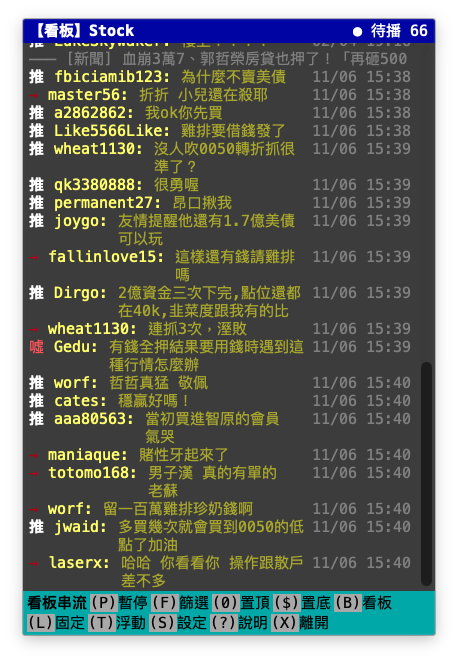
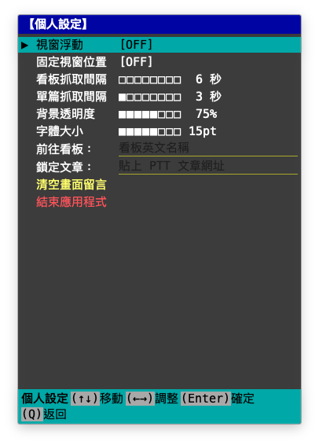
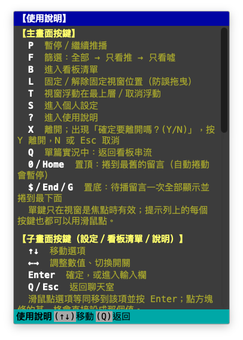

# PTT Marquee (批踢踢桌面即時浮動聊天室)

一款為 macOS 設計、仿 PTT telnet 終端機風格的原生浮動聊天室桌面小工具。即時抓取 PTT 網友留言並以擬真的聊天串流平滑推播，讓你在桌面邊緣隨時感受如同實況聊天室般的熱鬧氛圍！


| 看板串流 | 個人設定 | 使用說明 |
| :---: | :---: | :---: |
|  |  |  |

---

## ✨ 核心特色

1. **實況聊天室 Overlay 體驗**：
   - 無邊框、仿 PTT telnet 終端機風格的視窗（黑底等寬字、藍底標題列、青底提示列），支援自訂視窗層級：
     - **浮動模式（預設）**：浮動在所有應用最上層。
     - **正常層級模式**：點擊其他應用程式時，聊天室會自然被覆蓋在後面，工作不干擾。
   - 擬真平滑推播：多篇文章推文聚合後放入 FIFO 隊列，依適應性節奏一筆筆推入，模擬即時聊天室熱鬧發言。
2. **📜 智慧滾動與閱讀模式**：
   - **自動跟隨滾動**：新推文湧入時，自動平滑滾動到最底部。
   - **往上捲暫停機制**：只要你往上滾動瀏覽歷史留言，自動滾動**立即暫停**，保護閱讀視線不被干擾。
   - **`▼ 有 N 則新留言 ($)置底` 提示列**：往上捲時底部浮現，顯示待讀留言數，點擊或按 `$` / `End` / `G` 即可置底。
   - **置頂／置底**：`0`（或 Home）捲到最舊的留言並暫停自動捲動；`$`（或 End / G）把待播留言一次全部顯示並捲到最下面，不用等一則一則跳出來。
   - **依文章分隔線**：每篇文章的推文以一條分隔線（含文章標題）分組，點擊分隔線即可在瀏覽器開啟該篇；同一批推文會依文章聚在一起推播。
3. **🎯 雙模式：看板串流 vs 單篇即時實況串**：
   - **看板聚合模式**：自動監聽全板最新活躍文章推文混流（預設股板 Stock，可切換八卦、棒球、希洽、NBA、LoL 等），推文依來源文章以分隔線分組。
   - **單篇實況模式（球賽 / 重大事件 Live）**：
     - 在聊天室任意留言點擊**滑鼠右鍵** ➔ 選擇「鎖定此篇為實況聊天室」，或在設定中貼上網址。
     - **精簡純淨排版**：單篇實況時，標題列顯示該篇文章標題，留言列表**自動隱藏重複的文章分隔線**，化身極致簡潔的直播聊天串！
     - 按 `Q`（或點提示列上的 `(Q)返回看板`）即可隨時返回看板串流。
4. **💾 設定與視窗記憶（Persistence）**：
   - 自動記憶所有自訂參數（透明度、字體大小、是否浮動在最上層、是否固定位置、最後造訪的看板）。
   - 自動記憶視窗在桌面上的擺放位置與大小，下次啟動無縫恢復！
5. **⌨️ 鍵盤優先的終端機操控**：
   - **藍底標題列**：未固定時按住即可拖曳視窗。
   - **青底提示列**：列出可用按鍵，每個 `(K)` 區塊都可用滑鼠點擊。
   - **全螢幕子畫面**：`S` 設定、`B` 看板清單、`?` 說明，`Q` 或 `Esc` 返回聊天室；設定以方向鍵調整透明度、字體大小與抓取頻率。
   - **`X` 離開**：出現「確定要離開嗎？(Y/N)」確認列，按 `Y` 離開、`N` 或 `Esc` 取消。
   - `T` 切換視窗浮動（永遠在最上層）、`L` 固定視窗位置防誤拖曳。
6. **🧹 推文篩選與推播控制**：
   - `F` 依序切換「全部 → 只看推 → 只看噓」。
   - `P` 暫停／繼續推播（暫停時同時停止抓取），藍底標題列即時顯示「● 待播 N」。
   - 點擊分隔線可直接在瀏覽器開啟原文；右鍵選單可開啟或複製網址、留言內文、使用者 ID。
7. **🔄 可調抓取頻率**：
   - 看板聚合模式：每 5~30 秒抓一次（預設 8 秒，建議 6~10 秒，避免被 PTT 暫時擋 IP）。
   - 單篇實況模式：每 2~15 秒抓一次（預設 3 秒）。
   - PTT 網頁版偶爾會卡住十幾秒；單次失敗會在下一輪自動重試，**連續失敗 3 次**才在提示列上方顯示中文紅字（例如「PTT 連線逾時，重試中…」），成功一次或暫停時自動消失。

> **用詞說明**：「置頂／置底」指捲動訊息列表；視窗永遠在最上層稱為「浮動」（`T`）；防誤拖曳稱為「固定」（`L`）；「鎖定」只用於「鎖定此篇為實況聊天室」。

---

## 📋 環境需求

- macOS 13.0 以上
- Xcode（Swift 5.9 以上）
- [XcodeGen](https://github.com/yonaskolb/XcodeGen)（只有在新增、刪除檔案或修改專案設定時才需要）

---

## 🚀 快速啟動

在終端機執行：
```bash
./run.sh
```
或在 Xcode 開啟 `PTTMarquee.xcodeproj` 按下 `Cmd + R`。

### 從原始碼建置

```bash
# 只 build、不啟動（可看到完整編譯錯誤）
xcodebuild -project PTTMarquee.xcodeproj -scheme PTTMarquee -destination 'platform=macOS' build

# 新增／刪除原始檔或修改 project.yml 後，重新產生 Xcode 專案
xcodegen generate

# 執行單元測試
xcodebuild -project PTTMarquee.xcodeproj -scheme PTTMarquee -destination 'platform=macOS' test
```

> `project.yml` 是專案設定的唯一來源，`PTTMarquee.xcodeproj` 由 XcodeGen 產生，請勿手動修改。

### 打包發佈版

```bash
./scripts/package.sh   # Release、Apple Silicon + Intel universal，輸出 dist/PTTMarquee-<版本>.dmg 與 .zip
```

版本號取自 `project.yml` 的 `MARKETING_VERSION`。

**安裝**：打開 `.dmg`，把 `PTTMarquee.app` 拖到「應用程式」；或解壓 `.zip` 直接執行。
本 app 僅以 ad-hoc 簽章、未經 Apple 公證，第一次開啟時 macOS 會阻擋：請在「應用程式」中對 app **按右鍵 →「打開」→「打開」**（或到「系統設定 → 隱私權與安全性」按「強制打開」）。之後即可正常開啟。

### App 圖示

圖示由程式繪製（黑底、藍標題列、大「推」字加底線游標、青提示列）。要調整時修改 `scripts/AppIcon.swift`，再執行：

```bash
./scripts/make-app-icon.sh   # 重新產生 16～1024px 各尺寸到 AppIcon.appiconset
```

---

## ⌨️ 常用快捷操作

| 按鍵 | 動作 |
| :--- | :--- |
| `P` | 暫停／繼續推播 |
| `F` | 依序切換「全部 → 只看推 → 只看噓」 |
| `B` | 進入看板清單畫面 |
| `L` | 固定／解除固定視窗位置（解除後可拖曳藍底標題列） |
| `T` | 視窗浮動在最上層／取消浮動 |
| `S` | 進入設定畫面 |
| `?` | 進入說明畫面 |
| `X` | 離開應用程式（再按 `Y` 確認，`N` / `Esc` 取消） |
| `Q` | 單篇模式：返回看板串流；子畫面：返回聊天室 |
| `0` / `Home` | 置頂：捲到最舊的留言（自動捲動暫停） |
| `$` / `End` / `G` | 置底：待播留言一次全部顯示並捲到最下面（MacBook 沒有 Home/End 鍵，故以 `0`、`$`、`G` 為別名） |
| `↑` `↓` `←` `→` `Enter` `Esc` | 在子畫面中移動、調整、確認、返回 |
| `⌘ + ⇧ + L` / `⌘ + ⇧ + P` | 全域快捷鍵：切換固定視窗位置（在其他 App 中使用需授予「輔助使用」權限） |

- 在文字輸入框（設定中的看板、鎖定文章網址）輸入時，單鍵快捷鍵暫時停用。
- 在留言上按右鍵 ➔「鎖定此篇為實況聊天室」，或在設定中貼上網址，即可進入單篇實況；點擊提示列上的 `(K)` 區塊等同按鍵。

---

## 🏗️ 專案結構

```
PTTMarquee/
├── PTTMarqueeApp.swift          # App 進入點、AppDelegate
├── WindowController.swift       # 無邊框浮動 NSPanel、浮動/固定同步、全域快捷鍵
├── Models/                      # PTTBoard（預設看板清單）、PTTMessage（推文 + 去重 key）
├── Services/
│   ├── PTTCrawlerService.swift  # 抓取 www.ptt.cc 網頁（帶 over18 cookie）
│   ├── HTMLParser.swift         # 以正規表示式解析文章列表、推文、文章資訊
│   └── MessageQueueManager.swift# 去重 FIFO 隊列 + 適應性推播節奏（同批依文章分組）
├── ViewModels/
│   ├── ChatViewModel.swift      # 輪詢迴圈、模式切換、設定持久化、按鍵派發
│   ├── KeyCommand.swift         # 按鍵 → 指令對應
│   ├── TerminalScreen.swift     # 畫面狀態（聊天室／設定／看板／說明）
│   └── ChatRow.swift            # 留言與文章分隔線的列模型
└── Views/                       # ChatOverlayView、TerminalMessageRow
    └── Terminal/                # 主題、標題／提示列、分隔線、設定／看板／說明子畫面
PTTMarqueeTests/                 # 單元測試（按鍵對應、分組、分隔線、方塊條、置頂/置底、錯誤門檻、設定標籤長度）
scripts/                         # App 圖示產生腳本
docs/superpowers/                # telnet 改版的設計文件（specs/）與實作計畫（plans/）
```

## ⚙️ 運作原理

1. **抓取**：`ChatViewModel` 持續輪詢。
   - 看板模式：抓看板最新 8 篇文章，數量不夠時會補抓上一頁，並略過置底公告；接著並行抓取每篇的推文。
   - 單篇模式：只抓鎖定的那一篇。
2. **去重與排隊**：`MessageQueueManager` 以「看板 + 文章 + 帳號 + 內容 + 時間」為 key 過濾已看過的推文，新推文進入 FIFO 隊列。
3. **推播**：依隊列長度動態調整推出間隔（積壓越多越快，0.25 秒～1.2 秒），模擬實況聊天室節奏；畫面最多保留 150 則。
4. **單篇實況首次載入**：直接顯示最新 40 則留言，之後只推播新出現的推文。

## ⚠️ 注意事項

- 本工具透過爬取 PTT 網頁版（www.ptt.cc）取得資料，PTT 網頁改版可能導致解析失敗（此時會看不到任何推文）。
- PTT 網頁版（經 Cloudflare）實測約每兩分鐘會卡住一次（15～30 秒無回應或 HTTP 525），與本工具的請求頻率無關；此時短暫沒有新推文屬正常現象。
- 執行單元測試會以 app 本身為宿主：會開出聊天室視窗、連線 PTT，且使用與 app 相同的設定（UserDefaults）。
- 請勿把抓取頻率調得過快，以免對 PTT 造成負擔或被暫時封鎖 IP。
- 需要年滿 18 歲才能瀏覽的看板（如八卦板）會自動帶上 `over18` cookie。
